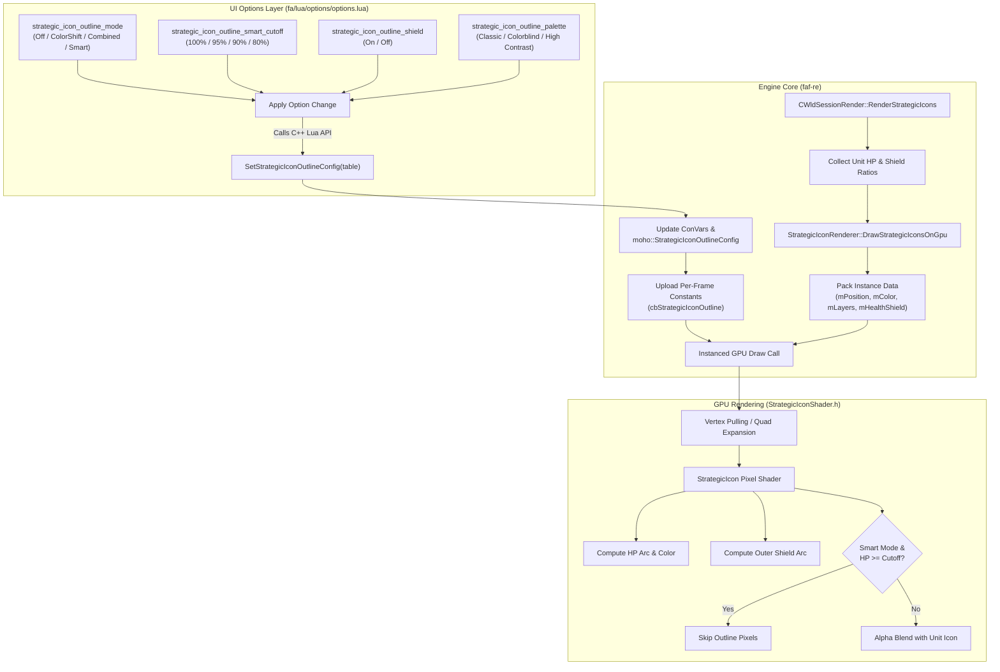

# Design Spec: Strategic Icon HP and Shield Outline

- **Date:** 2026-11-15
- **Feature:** `feat/strategic-icon-hp-outline`
- **Scope:** Native C++ Engine (`faf-re`) + Standard FAF Lua UI Options (`fa`)
- **Compatibility:** 100% Retail Replay & Multiplayer Compatible (`ForgedAlliance.exe` + `faf-re`), Zero-Sim Desync Risk (Client-Only Rendering)

---

## 1. Problem Statement & Motivation

In *Supreme Commander: Forged Alliance*, maintaining tactical awareness during battles requires tracking unit health. The game currently provides horizontal lifebars (`ToggleLifeBarsOn` / `ToggleLifeBarsOff`):
1. **Extreme Visual Clutter:** In mid-to-late game engagements involving hundreds or thousands of units, stacked horizontal lifebars overlap each other, obscure the terrain, and turn the screen into a noisy wall of green/yellow bars.
2. **Disconnected Spatial Geometry:** Lifebars hover offset above or below unit strategic icons. When units are tightly clustered, it becomes difficult to tell which bar belongs to which icon.
3. **Loss of Peripheral Recognition:** Players often toggle lifebars off entirely to see the map, sacrificing critical information on which frontline units are under fire and need to be pulled back or focused down.

**Goal:**
Integrate high-performance, GPU-rendered health and shield indicators directly into the outline (border) of strategic icons. Provide four clean operating modes (Default, Color Shift, Combined, and Smart Clutter-Free) with customizable color palettes, shield indication, and complete configuration inside the standard game options menu (`F10 -> Options -> Interface`), while exposing an open C++ Lua API for UI modders.

---

## 2. Hard Constraints & Design Principles

1. **Zero Sim Modification & 100% Determinism:**
   - Strategic icon rendering is strictly a client-side visual presentation subsystem (`CWldSessionRender` / `StrategicIconRenderer`).
   - Does not affect simulation state, random number generators, or network packets.
   - Zero risk of multiplayer desyncs; identical checksum behavior in headless replay tests.
2. **Native GPU Performance (Zero CPU Bottlenecks):**
   - High unit counts (2,000–5,000 active units) must render at high frame rates without CPU allocation overhead.
   - Contour rendering and radial sweep are computed directly on the GPU in `StrategicIconShader.h` using instanced rendering (`ren_GpuIcons`).
3. **No Console-Only Features (Rule 5 Compliant):**
   - Every setting has a first-class UI toggle in `fa/lua/options/options.lua` under `Interface`.
   - Players never need developer console commands or startup flags to configure their icon outlines.
4. **Ruthless Simplicity (YAGNI):**
   - Avoid complex per-category unit filtering in the base UI to keep settings intuitive.
   - Keep all settings consolidated inside the standard `Options` menu rather than creating floating windows or cluttering the top bar.
5. **Open Lua C++ API for Modders:**
   - Engine exports `SetStrategicIconOutlineConfig(table)` and `GetStrategicIconOutlineConfig()`.
   - UI modders can script custom color themes, animation effects, or custom presets without modifying C++ source.
6. **Documentation First:**
   - All new ConVars (`ui_StrategicIconHpOutlineMode`, etc.) are documented in [docs/SWITCHES.md](file:///i:/ProjectsFaf/faf-re/docs/SWITCHES.md).

---

## 3. Visual Modes & Mechanics

### 3.1. Outline Modes

| Mode ID | Mode Name | Visual Behavior |
| :--- | :--- | :--- |
| `0` | **Default (Off)** | Vanilla FA rendering. Strategic icons retain standard team-colored base and underlays with no HP outline. |
| `1` | **Color Shift** | Closed, unbroken perimeter outline around the icon. The outline color dynamically transitions based on HP fraction: Good Color ($>65\%$) $\rightarrow$ Warning Color ($65\%-30\%$) $\rightarrow$ Critical Color ($<30\%$). |
| `2` | **Combined (Sweep + Color)** | Outline sweeps clockwise from 12 o'clock, with arc length equal to $\text{fraction} = \frac{\text{Health}}{\text{MaxHealth}}$. Arc color simultaneously transitions from Good to Warning to Critical as HP drops. |
| `3` | **Smart Clutter-Free** | Identical to Combined sweep + color, but **completely hidden** when unit HP is at or above `hide_above_hp` (configurable: 100%, 95%, 90%, 80%). Uninjured units produce zero outline clutter. |

### 3.2. Shield Outline Layer & Fog of War Rules

- **Friendly / Allied Units (and Observers/Replays with full intel):**
  - For units with an active shield generator (`UserUnit::mUnitVarDat.mShieldRatio > 0.0f`):
    - A concentric outer ring is rendered around the unit's HP outline in the designated Shield Color (`0xFF00C8FF`).
    - When damaged, the shield ring sweeps down proportionally to remaining shield energy (`0.0f` – `1.0f`).
    - When the shield collapses (`shieldRatio == 0.0f`), the outer ring vanishes immediately.
- **Enemy Units (Intel & Fair Play Rule):**
  - **No Shield Hitpoint Leaks:** In Supreme Commander fog of war, opponents must not know the exact numerical shield reserve of enemy units.
  - For enemy units, the shield outline is strictly **binary (On / Off)**:
    - If the enemy shield is active (`shieldRatio > 0.0f`), a **full 100% outer shield ring** is shown (indicating the presence of an active shield).
    - It does **not** sweep or deplete as the shield takes damage.
    - When the enemy shield breaks (`shieldRatio <= 0.0f`), the ring vanishes instantly.
- Units without shields never render the outer shield ring.
- Can be toggled on/off in options (`ui_StrategicIconHpOutlineShield`).

### 3.3. Color Palettes

Configurable palette presets in options:
1. **Classic:** Good = Green (`#22C55E`), Warning = Yellow/Orange (`#EAB308`), Critical = Red (`#EF4444`), Shield = Cyan (`#00C8FF`).
2. **Colorblind (Deuteranopia/Protanopia):** Good = Blue (`#3B82F6`), Warning = Amber (`#F59E0B`), Critical = Red/Magenta (`#F43F5E`), Shield = Cyan (`#06B6D4`).
3. **High Contrast Neon:** Good = Bright Green (`#00FF66`), Warning = Gold (`#FFD700`), Critical = Crimson (`#FF0033`), Shield = Electric Blue (`#00E5FF`).

---

## 4. Architecture & Subsystems



---

## 5. Detailed Component Specifications

### 5.1. C++ Configuration Structure (`CWldSession.h`)

```cpp
namespace moho
{
  enum class EStrategicIconOutlineMode : std::uint8_t
  {
    None = 0,
    ColorShift = 1,
    Combined = 2,
    Smart = 3,
  };

  struct StrategicIconOutlineConfig
  {
    EStrategicIconOutlineMode mMode = EStrategicIconOutlineMode::None;
    float mSmartCutoff = 1.0f;           // Hide when health >= cutoff
    bool mShowShield = true;             // Render outer shield ring
    float mGoodCutoff = 0.65f;           // HP > 65% is Good Color
    float mBadCutoff = 0.30f;            // HP < 30% is Bad Color
    std::uint32_t mColorGood = 0xFF22C55E;
    std::uint32_t mColorMed  = 0xFFEAB308;
    std::uint32_t mColorBad  = 0xFFEF4444;
    std::uint32_t mColorShield = 0xFF00C8FF;
  };
}
```

### 5.2. Instance Data Packing

In `StrategicIconRenderer.h`:
Extend `StrategicIconInstance` (or pack into existing padding / supplementary per-instance buffer):
```cpp
struct StrategicIconInstance
{
  std::uint32_t mPosition = 0U;   ///< x low 16 bits, y high 16 bits
  std::uint32_t mColor = 0U;      ///< ARGB tint of base icon
  std::uint32_t mLayers01 = 0xFFFFFFFFU;
  std::uint32_t mLayers23 = 0xFFFFFFFFU;
  std::uint32_t mHealthShield = 0U; ///< Health ratio (16-bit unorm) | Shield ratio (16-bit unorm)
};
```
- Health ratio ($0.0 - 1.0$) packed into bits 0..15 (`uint16_t(std::clamp(health, 0.0f, 1.0f) * 65535.0f)`).
- Shield ratio ($0.0 - 1.0$) packed into bits 16..31:
  - For **friendly/allied units** (or observers): actual shield ratio (`uint16_t(std::clamp(shield, 0.0f, 1.0f) * 65535.0f)`).
  - For **enemy units**: strictly binary (`shield > 0.0f ? 0xFFFFu : 0u`), preventing any hitpoint information leak.

### 5.3. GPU Shader Logic (`StrategicIconShader.h`)

1. **UV Coordinate Space:** Normalized icon coordinates $UV \in [-1, 1]$. Radius $r = \sqrt{u^2 + v^2}$, angle $\theta = \text{atan2}(u, -v)$ (starting at 12 o'clock, sweeping clockwise).
2. **Inner Icon vs Outer Outline:**
   - Inner radius $r \in [0.0, 0.75]$: Unit strategic icon texture.
   - HP outline band $r \in [0.75, 0.88]$:
     - Check mode:
       - Mode 1 (Color Shift): Always draw if $r$ is within band; color = interpolator based on `mHealth`.
       - Mode 2 (Combined): Draw if $\theta \le \text{healthFraction} \times 2\pi$; color = interpolator.
       - Mode 3 (Smart): Skip if $\text{healthFraction} \ge \text{smartCutoff}$; otherwise same as Mode 2.
   - Shield outline band $r \in [0.90, 1.00]$ (when enabled and `mShield > 0`):
     - Draw if $\theta \le \text{shieldFraction} \times 2\pi$; color = `mColorShield`.
3. **Antialiasing:** Procedural edge feathering using `fwidth()` / `smoothstep()` for crisp outlines at all zoom levels.

### 5.4. Lua C++ Bindings

In `src/moho/sim/CWldSessionLua.cpp`:
- `SetStrategicIconOutlineConfig(lua_State* L)`:
  - Accepts table: `{ mode = int, smart_cutoff = float, shield = bool, palette = string, ... }`.
  - Atomically updates C++ `StrategicIconOutlineConfig` and triggers cache update.
- `GetStrategicIconOutlineConfig(lua_State* L)`:
  - Returns current configuration table to Lua.

### 5.5. Options Menu UI (`fa/lua/options/options.lua`)

Integrated into `Interface` group:
1. `strategic_icon_outline_mode`:
   - Items: `[ { text = "Off", key = 0 }, { text = "Color Shift", key = 1 }, { text = "Combined", key = 2 }, { text = "Smart (Damage Only)", key = 3 } ]`
   - Default: `0`
2. `strategic_icon_outline_smart_cutoff`:
   - Items: `[ { text = "100% (Any Damage)", key = 1.0 }, { text = "95%", key = 0.95 }, { text = "90%", key = 0.90 }, { text = "80%", key = 0.80 } ]`
   - Default: `1.0`
3. `strategic_icon_outline_shield`:
   - Items: `[ { text = "Enabled", key = true }, { text = "Disabled", key = false } ]`
   - Default: `true`
4. `strategic_icon_outline_palette`:
   - Items: `[ { text = "Classic", key = "classic" }, { text = "Colorblind Friendly", key = "colorblind" }, { text = "High Contrast Neon", key = "neon" } ]`
   - Default: `"classic"`

---

## 6. Verification Plan & Testing

### 6.1. Simulation Determinism & Parity
- Run headless verification on benchmark replays:
  ```powershell
  .\bin\x64\Release\headless_x64.exe --replay tests/replays/28013017.fafreplay --exit-at 2000
  ```
- Compare checksum stream with and without outline enabled.
- Expected result: **100% byte-for-byte checksum match**. Zero desync risk.

### 6.2. Rendering Performance Benchmark
- Capture Tracy profile (`mcp-tracy` / `analyze_tracy_capture.py`) during a 2000-unit fleet engagement on `Seton's Clutch`:
  - Baseline: `ui_StrategicIconHpOutlineMode = 0`
  - Test: `ui_StrategicIconHpOutlineMode = 2` (Combined) and `3` (Smart)
  - Verify render pass frame time overhead is $< 0.15\text{ ms}$ on modern GPUs.

### 6.3. User Experience & Visual Scenarios
- **Unit at 100% HP:**
  - In Mode 1: Crisp green outline.
  - In Mode 2: Full 360-degree green sweep.
  - In Mode 3: Zero outline (clean unit icon).
- **Unit taking heavy damage ($<25\%$ HP):**
  - Crisp red arc, instantly recognizable against team color.
- **Shielded unit (e.g. Pillar tank or Shields):**
  - Blue outer arc visible while shield holds, collapsing when depleted.
- **Options toggle:**
  - Toggling in `F10 -> Options` applies immediately without restarting game.

---

## 7. Documentation Updates

Register all variables in [docs/SWITCHES.md](file:///i:/ProjectsFaf/faf-re/docs/SWITCHES.md):
- `ui_StrategicIconHpOutlineMode` (default: 0, live)
- `ui_StrategicIconHpOutlineSmartCutoff` (default: 1.0, live)
- `ui_StrategicIconHpOutlineShield` (default: 1, live)
- `ui_StrategicIconHpOutlinePalette` (default: 0, live)
